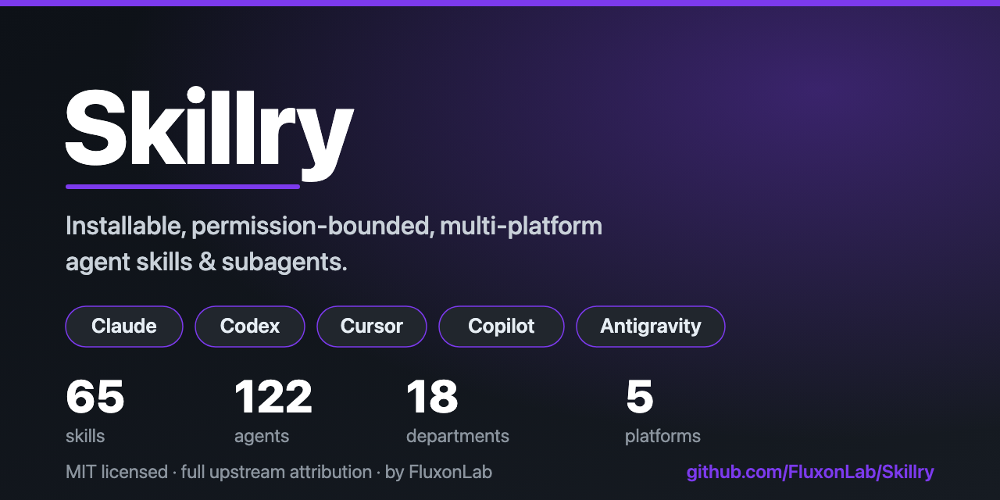
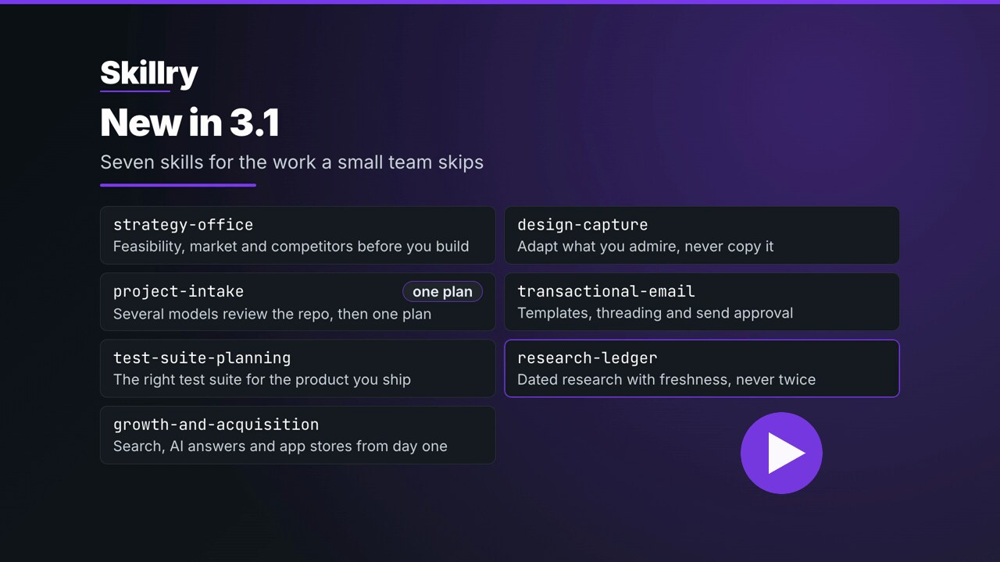

# Skillry

**Reusable, permission-bounded skills and agents for Claude Code, OpenAI Codex, Cursor, GitHub Copilot, Google Antigravity and OpenCode.**

One maintained library, adapted to each supported runtime without taking ownership of a project's
instruction files.

[Quickstart](#portable-installation) | [Platform contract](#platform-contract) | [Organization](#how-work-is-organized) | [Contributing](CONTRIBUTING.md)

---

## What's new in 3.3

Install only what you need, check it later, and remove it cleanly:

| Command | What it does |
| --- | --- |
| `skillry install --departments security core-operations` | Install chosen departments, or single skills with `--skills`; `--no-agents` leaves the agents out |
| `skillry list` | Show departments, skills and agents, and what each platform has installed |
| `skillry doctor` | Compare installed files with their manifests and report missing or locally changed files |
| `skillry uninstall --targets claude` | Remove what Skillry wrote and keep the files you changed |

Install and uninstall preview first and write only with `--apply`. Choices are remembered per
platform, so an update keeps them; an update that would remove something you installed stops
until you pass `--allow-removal`.

OpenCode is the sixth platform. Skills go to `~/.config/opencode/skills`, and agents become
OpenCode subagents with a permission map. The new `free-model-workers` skill shows how a lead
agent hands small jobs to free models through `opencode run`, each in its own folder with tools
denied, and checks every result before using it. See the [install guide](docs/INSTALL.md) and
the [changelog](CHANGELOG.md).

## What's new in 3.2

Two skills that make a release prove itself the way a customer would:

| Skill | What it does |
| --- | --- |
| `real-user-release-gate` | Test a release the way a customer meets it: the whole product once as a baseline, then only the journeys a release touches, on a local or staging candidate with real providers and a real inbox. After deploy the checks are read-only; live sign-up, payment and account deletion stay with a human |
| `customer-lens-testing` | In the same session: use the product (all of it once, then the screens a release touches) as a free and paid customer at beginner, intermediate and expert level, score ease, motion and polish, and propose what you would want |

3.2 also carries the fixes from an independent review of 3.1 (installer, storage, packaging and docs). 3.2.2 set how often and where the gate runs; 3.2.3 installs Antigravity skills and agents where the app, the CLI and the IDE read them, answers clearly on Windows where the storage engine cannot run, and tests real installs on Linux, macOS and Windows. See the [changelog](CHANGELOG.md).

## What's new in 3.1

Seven first-party skills for the work a small team skips:

| Skill | What it does |
| --- | --- |
| `strategy-office` | Feasibility, market, competitors and finance before you build |
| `project-intake` | Several models review a new or inherited repo, settle what they disagree on, and leave one plan |
| `test-suite-planning` | The right test suite for the product you ship |
| `growth-and-acquisition` | Search, AI answers and app stores from the first draft |
| `design-capture` | Adapt what you admire, never copy it |
| `transactional-email` | Templates, threaded replies and an approval step before anything is sent |
| `research-ledger` | Dated research with freshness classes and a small CLI, so nothing is researched twice |

Install them like every other Skillry skill: preview first, then `--apply`.

## What Skillry provides

- Platform-ready skills and agent definitions maintained from a shared library.
- Capability routing across product, web, backend, mobile, desktop, UX, accessibility, SEO/GEO,
  games, AI, data, platform, SRE, security, QA, media, assets, and knowledge operations.
- Least-privilege agent boundaries and explicit attribution for redistributed community content.
- A dry-run-first portable installer so users can inspect destinations and changes before writing.

Skillry is a capability library, not a simulated company. Departments are discovery and routing
labels. They do not create permanent autonomous teams or require every task to pass through a
fixed organization chart.

## Portable installation

Requires **Node.js >= 16**, **Git**, and **Python 3** (`Python 3.11+` or `tomli` for
`tools/release-gate.py`).

Preview is the default and writes nothing:

~~~bash
npx github:FluxonLab/Skillry install
~~~

After reviewing the plan, apply it explicitly:

~~~bash
npx github:FluxonLab/Skillry install --apply
~~~

Targets can be limited. For example:

~~~bash
npx github:FluxonLab/Skillry install --targets claude codex
npx github:FluxonLab/Skillry install --apply --targets claude codex
~~~

The dry-run for the selected release is the authority for exact destination paths and planned
changes. Do not infer a destination from an old README, marketplace layout, or another runtime.

## Platform contract

The portable installer installs only platform skills and agent definitions.

| Platform | Installed payload | Project instructions remain project-owned |
|---|---|---|
| Claude Code | Skills and Claude-compatible agents | CLAUDE.md |
| OpenAI Codex | Skills and Codex-compatible agent profiles | AGENTS.md |
| Cursor | Native skills and agents with inherited model and explicit read-only intent | AGENTS.md and .cursor/rules |
| Gemini (`--targets antigravity`) | Skills and Gemini/Antigravity agents | GEMINI.md and AGENTS.md |
| GitHub Copilot | Skills and Copilot-compatible custom agents | .github/copilot-instructions.md and AGENTS.md |
| OpenCode | Skills and OpenCode subagents with a permission map | AGENTS.md |

The installer does **not** copy, generate, merge, append, reconcile, back up, or otherwise modify
project CLAUDE.md, AGENTS.md, GEMINI.md, or Copilot instruction files. Those files express local
project policy and must be authored and maintained by that project.

The repository's own CLAUDE.md and AGENTS.md govern contributions to Skillry. They are not portable
templates and are not installer payloads.

### Optional Jev advice

[Jev](docs/JEV.md) offers bounded selection, ranking and classification in ten
modes. It supports explicit advice for Codex, Claude, Cursor and both Antigravity
surfaces using the actual client's inventory. The lead still owns execution and
acceptance. Installation and external data-sharing configuration are separate,
explicit actions; availability alone does not demonstrate token savings.

### Optional storage lifecycle

The `storage-artifact-lifecycle` skill and [local engine](docs/storage-engine.md)
separate reproducible output from source, active state and durable archives.
Run `skillry storage --help` for explicit workspace, cleanup, intake and receipt
commands. Generic profiles start without automatic cleanup or archive authority.
Installing the skill does not install a background cleaner or change a project's
instruction files.

The separately built [macOS menu companion](apps/storage-companion/README.md)
uses the same engine for status, pause/resume and owner-selected scopes. Jev is
optional; its [operation-only storage caller](docs/storage-jev.md) does not borrow
an agent client's identity or upload private file contents. Machine-specific
paths, destinations and service policy belong to the owner's profile.

## How work is organized

Skillry favors a small orchestration model:

1. One lead owns scope, decisions, context, and the final result.
2. One writer applies a change, avoiding concurrent edits to the same artifact.
3. Temporary subagents are used only for bounded specialist work that benefits from isolation or
   parallelism. Each returns evidence, decisions, open questions, and a concise handoff, then ends.
4. Skills use progressive disclosure: route from metadata, load the selected SKILL.md, and open
   supporting references only when the task requires them.
5. Departments form a capability graph for routing and coverage. They are not standing managerial
   layers, mandatory queues, or personas kept alive between tasks.

This keeps routine work direct while retaining specialist depth for genuinely independent or
high-risk work.

## Library structure

- plugins/<department>/ contains first-party skills and agents grouped for discovery. Since 3.0.0
  each skill is a hub: its SKILL.md routes to references/, which can include attributed third-party
  material merged with a provenance header and its upstream license.
- community/<source>/ contains attributed third-party material with its upstream license.
- registry/ records distributable inventory and provenance.
- tools/ contains repository maintenance and portable installation tooling.
- docs/ contains public guides and durable project documentation.
- CLAUDE.md and AGENTS.md contain repository-only contributor instructions.

Counts and compatibility claims can change. Prefer the current registry, release notes, installer
dry-run, and primary platform documentation over copied summaries.

## Safety and provenance

- Give each agent only the tools and access its task requires.
- Keep review and audit work read-only unless mutation is explicitly requested.
- Treat third-party skills and agents as untrusted until their source, license, permissions, and
  behavior have been reviewed.
- Separate community material from first-party material and preserve upstream attribution.
- Make evidence-backed claims. Mark assumptions and unverified behavior instead of presenting them
  as facts.

## Contributing

See [CONTRIBUTING.md](CONTRIBUTING.md) for authoring and review requirements. Contributors working
inside this repository must also follow [CLAUDE.md](CLAUDE.md) or [AGENTS.md](AGENTS.md), depending
on the runtime they use. These files describe the same repository contract; neither is a template
for unrelated projects.

Security issues should be reported through [SECURITY.md](SECURITY.md). Governance and release
policy are documented in [GOVERNANCE.md](GOVERNANCE.md).

## License and credits

Original Skillry work is available under the [MIT License](LICENSE). Redistributed community
content retains its upstream license and attribution; see [NOTICE](NOTICE) and
[THIRD-PARTY-NOTICES.md](THIRD-PARTY-NOTICES.md).

Built and maintained by [FluxonLab](https://fluxonlab.com).
